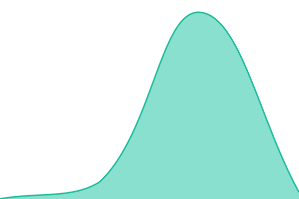

# Source Cooperative Status

External uptime monitoring and the public status page for [Source Cooperative](https://source.coop), at **[status.source.coop](https://status.source.coop)**. Built with [Upptime](https://upptime.js.org).

<!--start: status pages-->
<!-- This summary is generated by Upptime (https://github.com/upptime/upptime) -->
<!-- Do not edit this manually, your changes will be overwritten -->
<!-- prettier-ignore -->
| URL | Status | History | Response Time | Uptime |
| --- | ------ | ------- | ------------- | ------ |
|  [Website](https://source.coop/) | 🟩 Up | [website.yml](https://github.com/source-cooperative/status.source.coop/commits/HEAD/history/website.yml) | 

 557ms
     
 | 

<a href="https://status.source.coop/history/website">100.00%</a>
    

|  [Data proxy](https://data.source.coop/) | 🟩 Up | [data-proxy.yml](https://github.com/source-cooperative/status.source.coop/commits/HEAD/history/data-proxy.yml) | 

 120ms
     
 | 

<a href="https://status.source.coop/history/data-proxy">100.00%</a>
    

|  [Data reads](https://data.source.coop/radiantearth/landcovernet/README.md) | 🟩 Up | [data-reads.yml](https://github.com/source-cooperative/status.source.coop/commits/HEAD/history/data-reads.yml) | 

 1193ms
     
 | 

<a href="https://status.source.coop/history/data-reads">100.00%</a>
    

|  [Credential exchange](https://data.source.coop/.well-known/openid-configuration) | 🟩 Up | [credential-exchange.yml](https://github.com/source-cooperative/status.source.coop/commits/HEAD/history/credential-exchange.yml) | 

 86ms
     
 | 

<a href="https://status.source.coop/history/credential-exchange">100.00%</a>
    

|  [Sign-in](https://auth.source.coop/.well-known/openid-configuration) | 🟩 Up | [sign-in.yml](https://github.com/source-cooperative/status.source.coop/commits/HEAD/history/sign-in.yml) | 

 346ms
     
 | 

<a href="https://status.source.coop/history/sign-in">100.00%</a>
    

<!--end: status pages-->

## What we check

Every check runs every 5 minutes from GitHub Actions, outside Cloudflare, Vercel and AWS, so it keeps working when any of them is down. A check is **down** if the request fails, returns a non-2xx status, or the body lacks the expected text. It is **degraded** if it answers but takes longer than 5 seconds.

| Check               | URL                                                            | Expects                         | What a failure means                                                                                                                                                                   |
| ------------------- | -------------------------------------------------------------- | ------------------------------- | -------------------------------------------------------------------------------------------------------------------------------------------------------------------------------------- |
| Website             | `https://source.coop/`                                         | 2xx                             | The web app on Vercel isn't serving.                                                                                                                                                   |
| Data proxy          | `https://data.source.coop/`                                    | `Source Cooperative Data Proxy` | The data proxy Worker isn't running. This path makes no upstream calls, so a failure means Cloudflare or the Worker itself is down.                                                    |
| Data reads          | `https://data.source.coop/radiantearth/landcovernet/README.md` | `LandCoverNet`                  | Public data can't be read. This exercises the whole read path: a Source API lookup, AWS credentials, then S3. If **Data proxy** is up but this is down, look downstream of the Worker. |
| Credential exchange | `https://data.source.coop/.well-known/openid-configuration`    | `"issuer"`                      | S3 clients and the CLI can't discover the proxy's credential exchange (`/.sts`), so signed-in access fails.                                                                            |
| Sign-in             | `https://auth.source.coop/.well-known/openid-configuration`    | `"issuer"`                      | The identity provider (Ory) isn't answering, so users can't sign in or get credentials.                                                                                                |

The data-read check uses a Radiant Earth object because Source controls it; a third party deleting data can't cause a false outage.

Together, the checks narrow down where a problem is:

- **Everything down:** GitHub or the network between it and us. Check [githubstatus.com](https://www.githubstatus.com) before paging anyone.
- **Data proxy down:** Cloudflare or the Worker.
- **Only data reads down:** the Source API, AWS credentials or S3.
- **Only sign-in down:** Ory.

## How it works

Upptime runs entirely on GitHub; there is no server.

- **Checks** run in the **Uptime CI** workflow every 5 minutes, from the sites listed in [`.upptimerc.yml`](.upptimerc.yml).
- **Incidents are issues.** When a check goes down, Upptime opens an issue in this repository; when it recovers, Upptime closes it. Comments on the issue appear on the status page as incident updates.
- **Notifications go to Slack:** one message when a check goes down or degrades, and one when it recovers. Nothing repeats while an incident stays open.
- **History is commits.** Response times and status are committed to `history/`. The `api/` and `graphs/` folders hold the badges and charts, regenerated daily.
- **The status page** is a static site that the **Static Site CI** workflow builds and publishes to the `gh-pages` branch, served by GitHub Pages at `status.source.coop`.

This is the outside uptime check (M4) in [data.source.coop ADR-015](https://github.com/source-cooperative/data.source.coop/blob/main/adrs/015-observability.md). Cloudflare's own alerts cover failures inside the data proxy; this repository covers the case where Cloudflare itself, or everything, is unreachable.

## Changing what we check

Edit `sites` in [`.upptimerc.yml`](.upptimerc.yml) and open a pull request; the next scheduled run picks up the change after merge. Prefer checks that need no credentials and touch objects Source controls. Use `__dangerous__body_down_if_text_missing` to assert on the response body, not only the status code.

To post an update during an incident, comment on its open issue.

## Styling

The page is styled from the Source Cooperative brand (`ops-source` `brand/brand.json`). Upptime copies everything in [`assets/`](assets/) to the site root:

- `theme.css`: colours. Ink on Bone, with Grass only for up status.
- `brand.css`: fonts. IBM Plex Sans for body text; Berkeley Mono, loaded from the Radiant Earth CDN, for headings and labels.
- The logomark, favicon, touch icon and share image, copied from the private `ops-source` repository.

Berkeley Mono is licensed, so never commit its font files here.

## Setup

These are repository settings, not files:

| Setting                                 | Value                                                                                                     |
| --------------------------------------- | --------------------------------------------------------------------------------------------------------- |
| Secret `GH_PAT`                         | A token for this repository with the scopes in [Upptime's guide](https://upptime.js.org/docs/get-started) |
| Secret `NOTIFICATION_SLACK`             | `true`                                                                                                    |
| Secret `NOTIFICATION_SLACK_WEBHOOK_URL` | The alerts channel's Slack incoming webhook                                                               |
| DNS (Route 53, `source.coop`)           | CNAME `status` → `source-cooperative.github.io`                                                           |
| Pages                                   | Deploy from `gh-pages`, custom domain `status.source.coop`, HTTPS enforced                                |

## License

Upptime is [MIT-licensed](https://github.com/upptime/upptime/blob/master/LICENSE).
